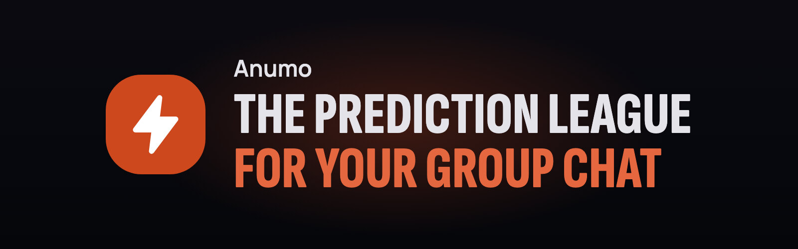
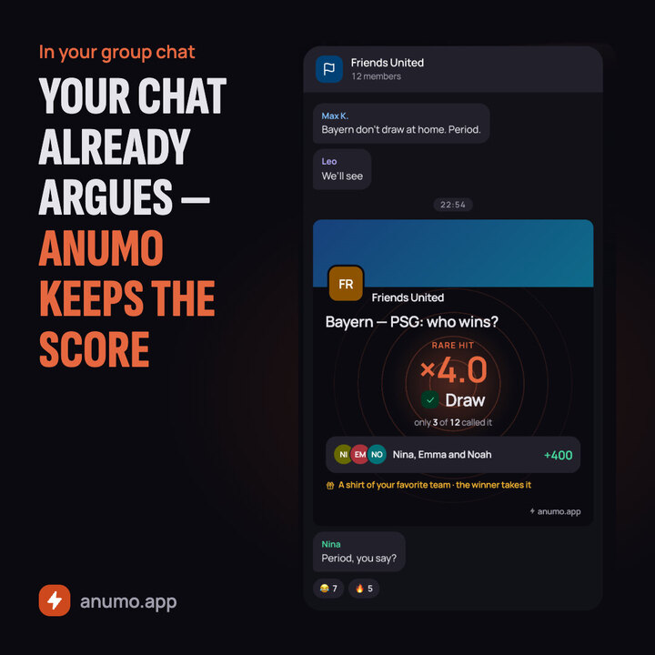
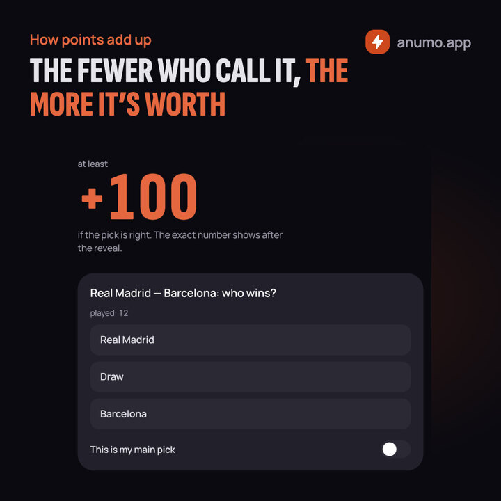
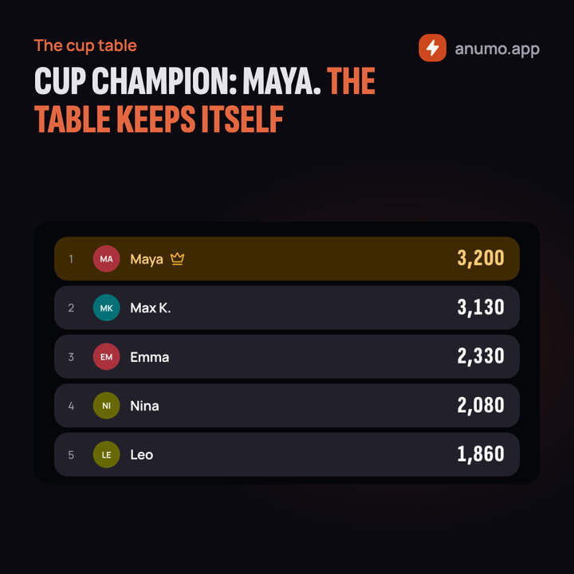
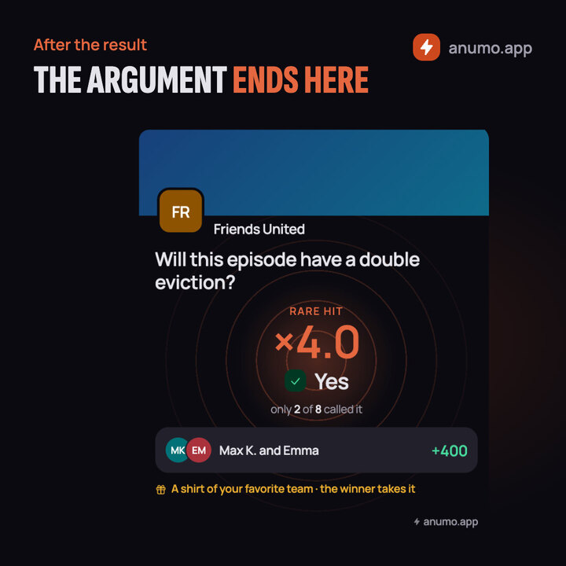
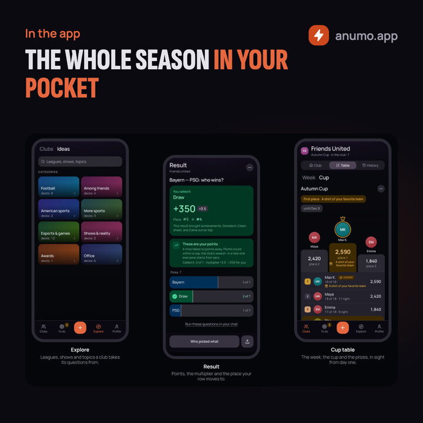
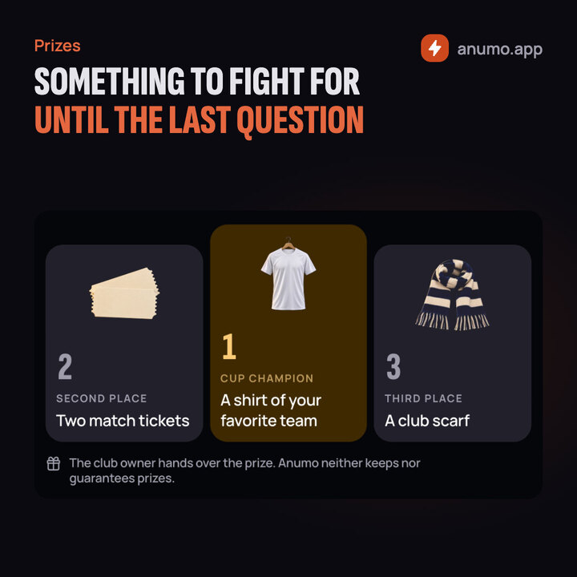

  

# Anumo

**A prediction league for your group chat.**
Drop a link in the chat, and everyone makes their picks in two taps. Anumo keeps the points, the cup table and the season’s champion by itself.

🌐 **[anumo.app](https://anumo.app)**

## Predict what you already argue about

- **Football:** the Champions League, the top European leagues and the big tournaments
- **Esports pick’em:** CS2, Valorant, Dota 2 and League of Legends
- **Shows and awards:** Eurovision, the Oscars, reality shows
- **Your own questions:** anything your group argues about

## How it works

1. Open a club and share its link in the chat
2. Everyone answers each question in two taps; picks stay hidden until the reveal
3. A correct pick earns more when fewer people saw it coming
4. Rounds add up to cups and a season table

  
  
  
  
  
  

Playing and running a club is free.

## Built with

PHP 8.5 · Laravel Octane · Inertia + React 19 · PostgreSQL · Redis
